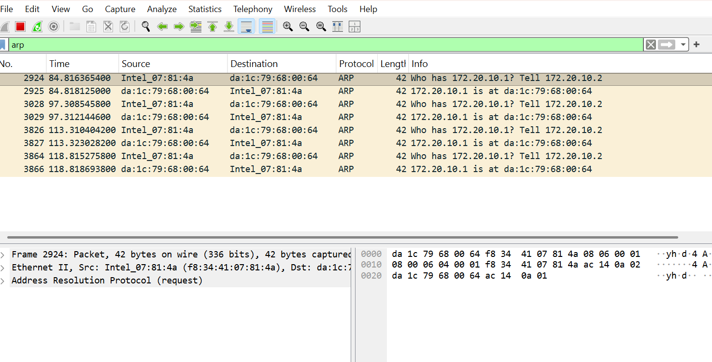
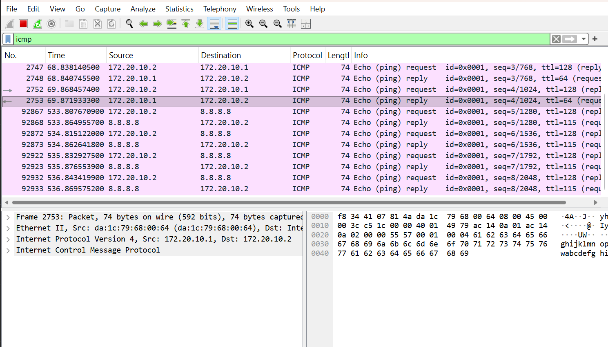
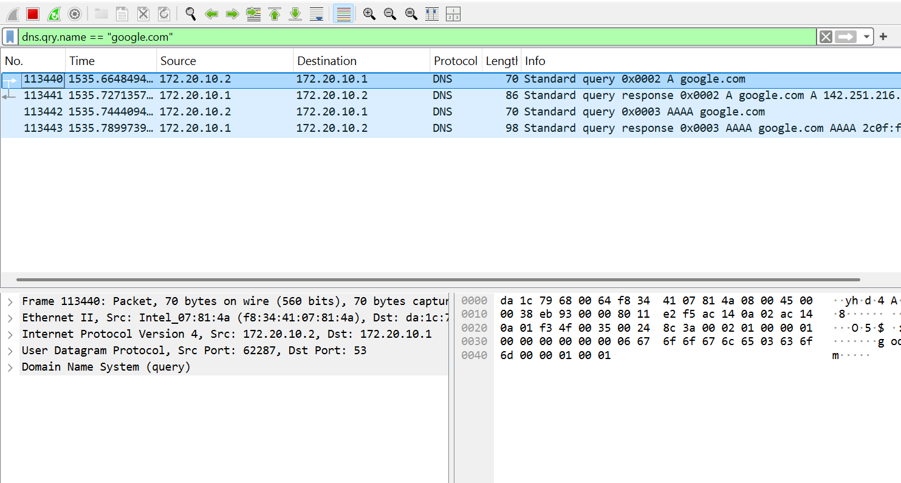
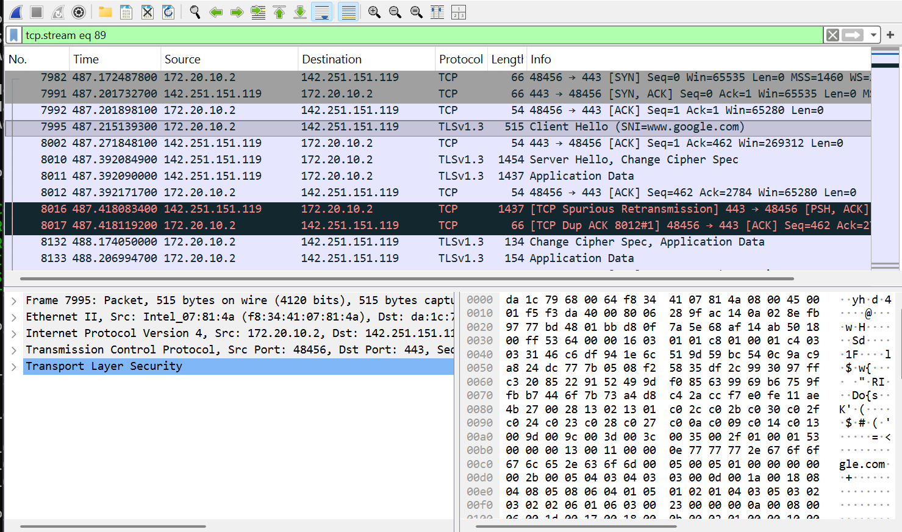
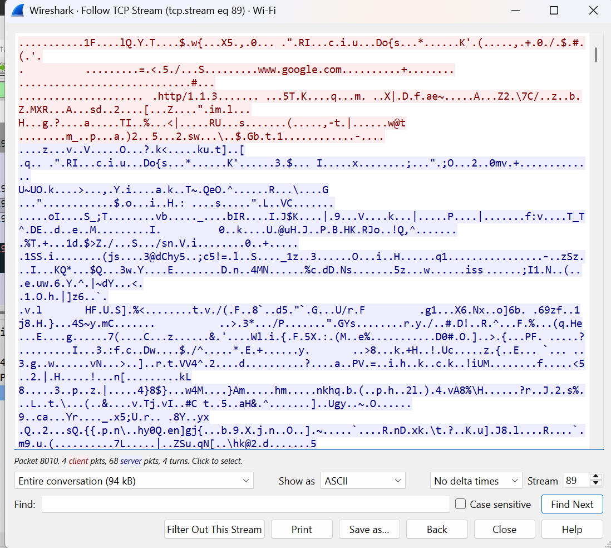
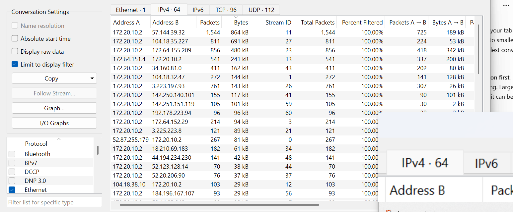

# Network Traffic Investigation

## About This Project

In this project, I used Wireshark to capture and review network traffic from my Windows computer.

My goal was to understand how common network protocols appear in a packet capture and how I can use Wireshark to follow communication between my computer and other systems.

## What I Worked On

- Captured live network traffic using Wireshark.
- Reviewed ARP request and reply traffic.
- Captured ICMP ping requests and replies.
- Generated and reviewed DNS traffic for `google.com`.
- Identified a TCP three-way handshake.
- Reviewed TLS traffic to `www.google.com`.
- Followed a TCP stream.
- Used Wireshark Conversations to compare network traffic between IP addresses.

## Tools Used

- Wireshark
- PowerShell
- Windows
- ping
- nslookup

  ## ARP Traffic

I started by looking at ARP traffic to understand how devices find each other on the local network.
My computer asked for the MAC address of `172.20.10.1`, and the device replied with its MAC address.

## ICMP Ping Traffic

I used `ping` to generate ICMP traffic and captured the request and reply packets in Wireshark.
I could see my computer `172.20.10.2` sending echo requests to `8.8.8.8` and receiving echo replies back.

## DNS Investigation

I used `nslookup google.com` to generate DNS traffic.
The capture showed my computer sending a DNS query to the local DNS server and receiving the IP address information for `google.com`.

## TCP and TLS Connection

I captured a connection to `www.google.com` and isolated the TCP conversation.
I identified the TCP three-way handshake:
- SYN
- SYN/ACK
- ACK
After the TCP connection was established, I could also see the TLS Client Hello, Server Hello, and encrypted Application Data.

## Following a TCP Stream

I used Wireshark's Follow TCP Stream feature to isolate one Google connection.

Most of the content was unreadable because the connection was protected by TLS encryption, but I could still see information such as `www.google.com`.

## Network Conversations

I used the IPv4 Conversations view to compare communication between different IP addresses.

I sorted the conversations by total bytes and found that one of the largest conversations involved my computer `172.20.10.2` and the remote IP `57.144.39.32`, with about `864 kB` of traffic exchanged.

## Key Findings

- ARP was used to map an IP address to a MAC address on the local network.
- ICMP showed successful ping requests and replies.
- DNS resolved `google.com` to IP address information.
- TCP used the SYN, SYN/ACK, and ACK process to establish a connection.
- TLS protected the web traffic after the connection was established.
- Wireshark allowed me to isolate individual conversations and compare traffic between IP addresses.

## What I Learned

This project helped me understand how common network protocols look in a real packet capture.

I also learned that I should not judge traffic only by the amount of data or by an unfamiliar IP address. I need more information before deciding whether something is suspicious.

## Conclusion

This project gave me practical experience capturing and reviewing normal network traffic with Wireshark.

I was able to generate my own traffic, apply filters, identify common protocols, follow a TCP conversation, and use Wireshark statistics to review communication between systems.
